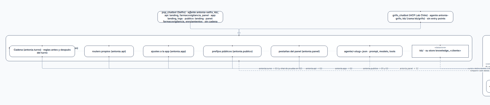

# G2: El título de un contenedor queda tapado por su primer hijo

## What
En contenedores (contains/nest) el primer hijo se dibuja encima de la cabecera del contenedor: «Superficie 2 · «abstract» Satélite» no se lee.

## Expected
La cabecera del contenedor reserva su alto y los hijos empiezan debajo.

## Where
frontends/mindmap/views/specs/notation (notation-view.js, notation.mjs) y el servidor (serve.py, sldb_adapter.py) para G1.

## Evidence
Reporte de la sesión de 2026-10-19 sobre un store de prueba de solo lectura con 6 specs de spec2viz (component, deployment, activity, matriz).
- 

## Acceptance
Criterio de aceptación (común a G1-G7): en /specs/notation, con «Ver todo», cada spec del store de prueba se lee al 100% de zoom en 1800x1200 (texto ≥ 10 px), sin títulos tapados, sin rótulos encimados y con la categoría del vistas.yml. Se verifica con capturas propias antes de cerrar.
