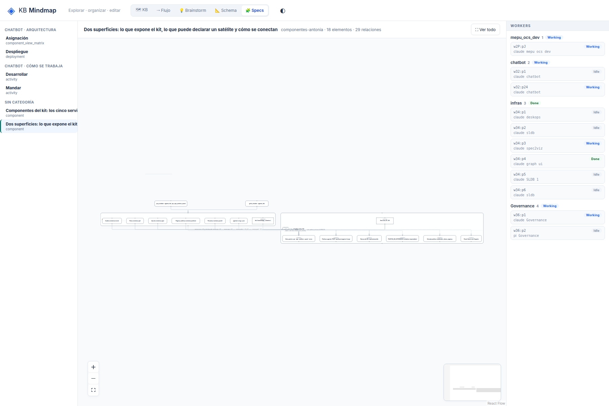
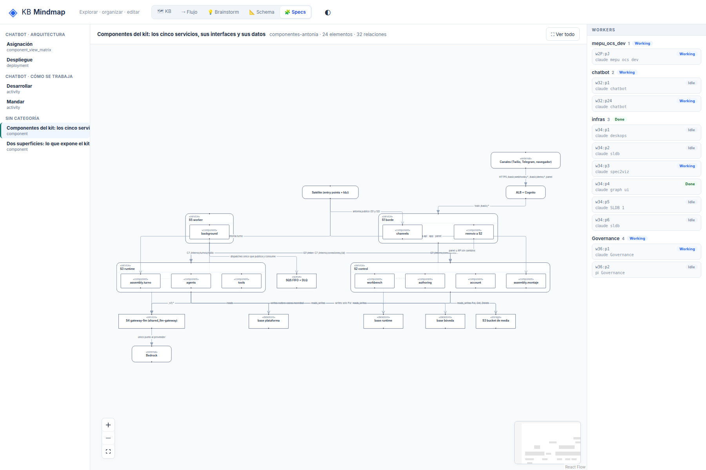
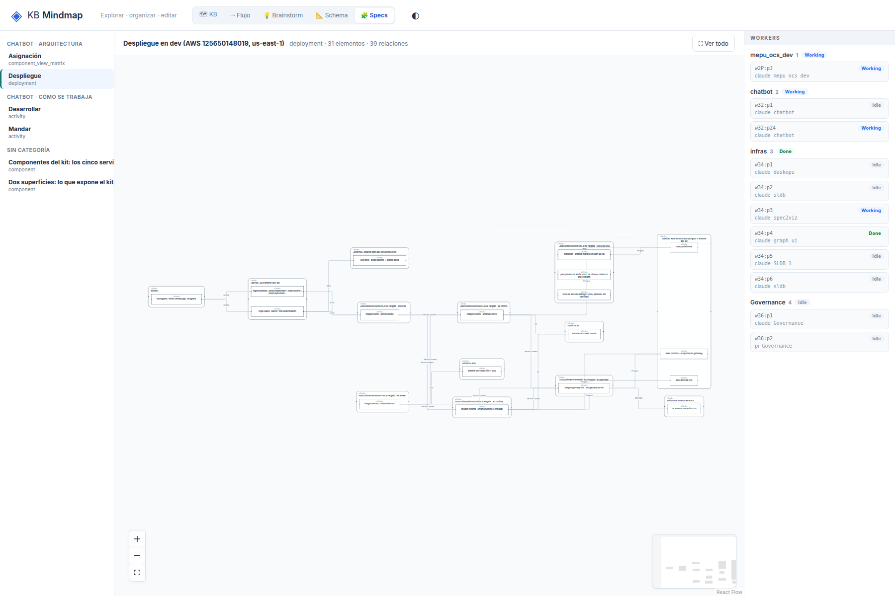

# G3: Los hijos de un contenedor quedan en una sola fila

## What
Todos los hijos de un contenedor se ponen en una fila horizontal: diagramas de 18 a 31 nodos quedan de ~1100x100 px con «Ver todo» e ilegibles (superficies, kit de componentes, despliegue).

## Expected
Distribuir los hijos en 2D con ELK (layout jerárquico con contenedores), no en una fila.

## Where
frontends/mindmap/views/specs/notation (notation-view.js, notation.mjs) y el servidor (serve.py, sldb_adapter.py) para G1.

## Evidence
Reporte de la sesión de 2026-10-19 sobre un store de prueba de solo lectura con 6 specs de spec2viz (component, deployment, activity, matriz).
- 
- 
- 

## Acceptance
Criterio de aceptación (común a G1-G7): en /specs/notation, con «Ver todo», cada spec del store de prueba se lee al 100% de zoom en 1800x1200 (texto ≥ 10 px), sin títulos tapados, sin rótulos encimados y con la categoría del vistas.yml. Se verifica con capturas propias antes de cerrar.

## Resolution

Closed: 2026-10-19
Reason: Los hijos sueltos de un contenedor se apilan en una grilla 2D (aristas invisibles de layout). Superficies pasa de zoom 0.30 a 1.02 y kit de 0.60 a 0.96 con Ver todo. Despliegue (31 nodos, todas sus aristas entre contenedores) queda en 0.72 = 9.1 px: el límite ya no es la fila sino la densidad y el ancho del lienzo (panel de workers); propuesta al coordinador.
Refs: b701555, f63edf3
