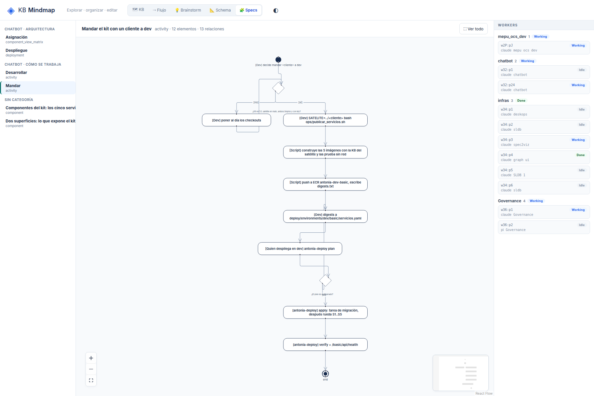

# G6: En actividad, el rótulo de la decisión queda fuera del rombo y los bucles pisan el flujo principal

## What
El rótulo de una decisión se dibuja debajo del rombo, encima de las aristas y de la guarda [sí]; los bucles (no → paso anterior) se superponen con el flujo principal.

## Expected
El rótulo de la decisión se lee sin encimarse con aristas ni guardas, y las aristas de vuelta se rutean por fuera del flujo principal.

## Where
frontends/mindmap/views/specs/notation (notation-view.js, notation.mjs) y el servidor (serve.py, sldb_adapter.py) para G1.

## Evidence
Reporte de la sesión de 2026-10-19 sobre un store de prueba de solo lectura con 6 specs de spec2viz (component, deployment, activity, matriz).
- 

## Acceptance
Criterio de aceptación (común a G1-G7): en /specs/notation, con «Ver todo», cada spec del store de prueba se lee al 100% de zoom en 1800x1200 (texto ≥ 10 px), sin títulos tapados, sin rótulos encimados y con la categoría del vistas.yml. Se verifica con capturas propias antes de cerrar.

## Resolution

Closed: 2026-10-19
Reason: El rombo contiene su rótulo; con el orden del spec las vueltas atrás se rutean al costado; e2e sobre el piloto de actividad.
Refs: b701555, f63edf3
