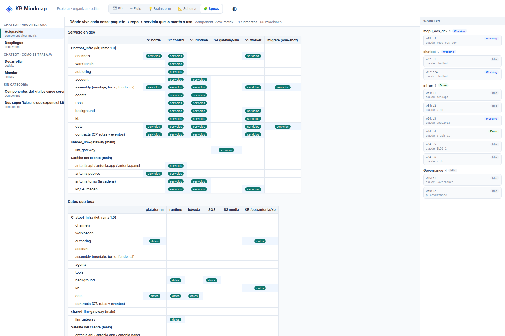

# G7: En la matriz, las celdas muestran el nombre de la vista en vez de una marca

## What
Las celdas de la matriz dicen el nombre de la vista («servicios», «datos») en lugar de una marca; se lee, pero es ruido.

## Expected
Una celda marcada muestra una marca (✓ o punto); el nombre de la vista queda en la cabecera de columna y en el title.

## Where
frontends/mindmap/views/specs/notation (notation-view.js, notation.mjs) y el servidor (serve.py, sldb_adapter.py) para G1.

## Evidence
Reporte de la sesión de 2026-10-19 sobre un store de prueba de solo lectura con 6 specs de spec2viz (component, deployment, activity, matriz).
- 

## Acceptance
Criterio de aceptación (común a G1-G7): en /specs/notation, con «Ver todo», cada spec del store de prueba se lee al 100% de zoom en 1800x1200 (texto ≥ 10 px), sin títulos tapados, sin rótulos encimados y con la categoría del vistas.yml. Se verifica con capturas propias antes de cerrar.

## Resolution

Closed: 2026-10-19
Reason: La celda marcada muestra un ●; el detalle va en title/aria-label; e2e de la grilla.
Refs: 0bb7223
