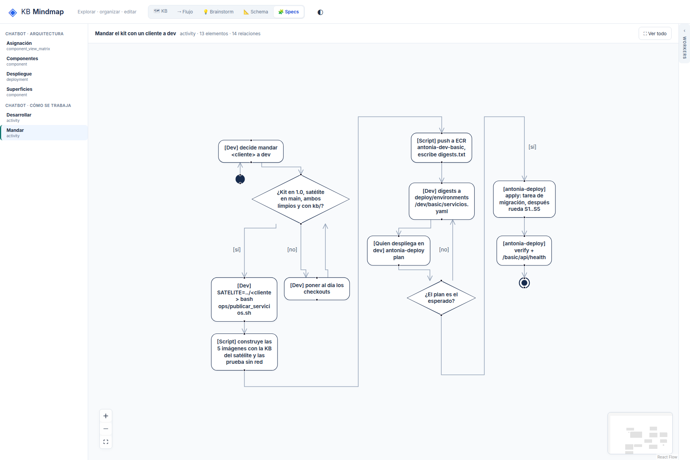

# R1: En actividad, el nodo inicial queda debajo del primer paso

## What
En ambos specs de actividad el pseudoestado inicial se dibuja debajo del primer paso y su flecha sube.

## Expected
El inicial es la primera capa del layout (arriba, en la dirección del flujo), como el final es la última.

## Where
frontends/mindmap/views/specs/notation (notation-layout.mjs, notation-view.js).

## Evidence
Ronda 2 del reporte de legibilidad (2026-10-19), sobre el store de prueba de solo lectura, después de b701555.
- 
- 

## Acceptance
Aserción: el centro del inicial está antes (arriba en TB) que el del primer paso.
Criterio (ronda 2): en /specs/notation, 1800x1200, «Ver todo»: texto ≥ 10 px, sin títulos tapados ni rótulos encimados, y además sin puntas de flecha sueltas, cada rótulo de arista a ≤ 20 px de su arista y el nodo inicial arriba. Cada issue tiene su aserción en tests/e2e_notation_legibility.py.
