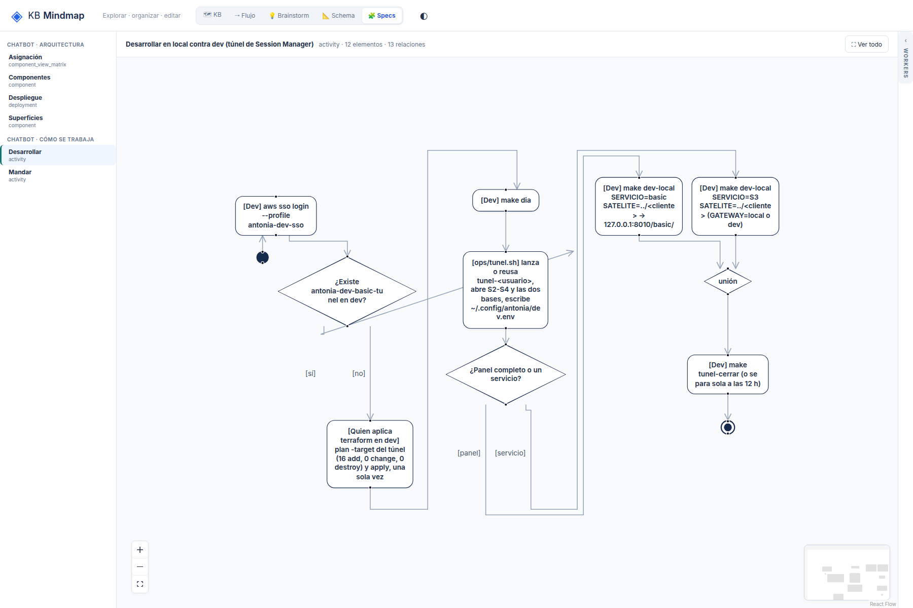

# R2: Una arista sin ruta ortogonal se dibuja como diagonal con puntas sueltas

## What
En desarrollar-contra-dev la rama «sí» de una decisión se dibuja como diagonal que cruza el rombo y termina en una punta en el vacío; hay otra punta suelta junto a un paso.

## Expected
Toda arista tiene ruta y sus dos extremos tocan su origen y su destino; si ELK no la rutea, se dibuja entre los puertos de los nodos, nunca al aire.

## Where
frontends/mindmap/views/specs/notation (notation-layout.mjs, notation-view.js).

## Evidence
Ronda 2 del reporte de legibilidad (2026-10-19), sobre el store de prueba de solo lectura, después de b701555.
- 

## Acceptance
Aserción: cada arista empieza y termina sobre el borde de su origen y su destino.
Criterio (ronda 2): en /specs/notation, 1800x1200, «Ver todo»: texto ≥ 10 px, sin títulos tapados ni rótulos encimados, y además sin puntas de flecha sueltas, cada rótulo de arista a ≤ 20 px de su arista y el nodo inicial arriba. Cada issue tiene su aserción en tests/e2e_notation_legibility.py.

## Resolution

Closed: 2026-10-19
Reason: Las ramas de un rombo usan sus vértices (puertos fijos) y un candidato con arista diagonal o extremo al aire se descarta; e2e: cada arista empieza y termina sobre su origen y su destino.
Refs: 3bfb7f5
