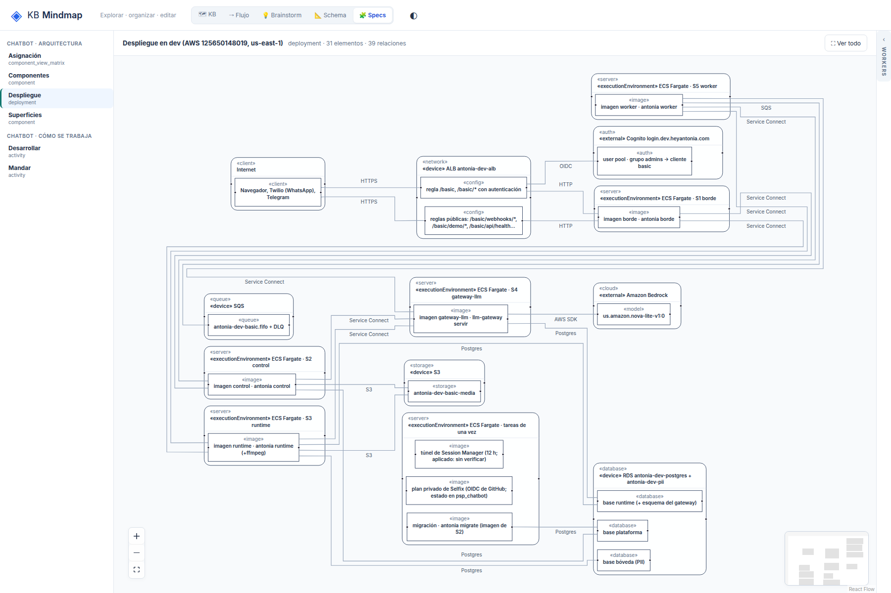

# R3: Los rótulos de arista quedan lejos de su línea

## What
Guardas [sí]/[no], rótulos de entry points y «Service Connect» flotan en filas o columnas sin tocar su tramo; no se sabe qué arista rotulan.

## Expected
Cada rótulo va pegado a un tramo de su arista (≤ 20 px).

## Where
frontends/mindmap/views/specs/notation (notation-layout.mjs, notation-view.js).

## Evidence
Ronda 2 del reporte de legibilidad (2026-10-19), sobre el store de prueba de solo lectura, después de b701555.
- 
- 
- 

## Acceptance
Aserción: la distancia del centro de cada rótulo a su arista es ≤ 20 px.
Criterio (ronda 2): en /specs/notation, 1800x1200, «Ver todo»: texto ≥ 10 px, sin títulos tapados ni rótulos encimados, y además sin puntas de flecha sueltas, cada rótulo de arista a ≤ 20 px de su arista y el nodo inicial arriba. Cada issue tiene su aserción en tests/e2e_notation_legibility.py.

## Resolution

Closed: 2026-10-19
Reason: Cada rótulo se coloca junto a un tramo de su arista (4 px) sin pisar nodos, títulos ni otros rótulos; e2e: cada rótulo a <= 20 px de su arista.
Refs: 3bfb7f5
