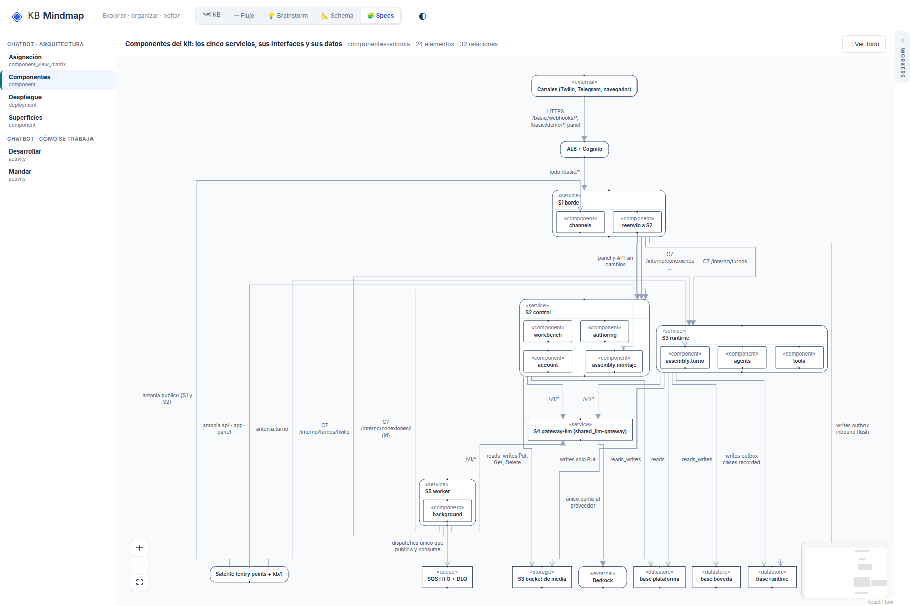

# R4: El minimapa tapa nodos tras «Ver todo»

## What
Con «Ver todo» el minimapa (abajo a la derecha) queda encima de nodos del diagrama.

## Expected
El encuadre descuenta el minimapa (o el minimapa no tapa el diagrama).

## Where
frontends/mindmap/views/specs/notation (notation-layout.mjs, notation-view.js).

## Evidence
Ronda 2 del reporte de legibilidad (2026-10-19), sobre el store de prueba de solo lectura, después de b701555.
- 

## Acceptance
Aserción: tras «Ver todo» el minimapa no intersecta ningún nodo.
Criterio (ronda 2): en /specs/notation, 1800x1200, «Ver todo»: texto ≥ 10 px, sin títulos tapados ni rótulos encimados, y además sin puntas de flecha sueltas, cada rótulo de arista a ≤ 20 px de su arista y el nodo inicial arriba. Cada issue tiene su aserción en tests/e2e_notation_legibility.py.

## Resolution

Closed: 2026-10-19
Reason: Minimapa plegable (arranca oculto, recordado); mostrado, «Ver todo» encuadra fuera de su esquina; e2e: no intersecta nodos en componentes, actividad y despliegue.
Refs: 3bfb7f5
