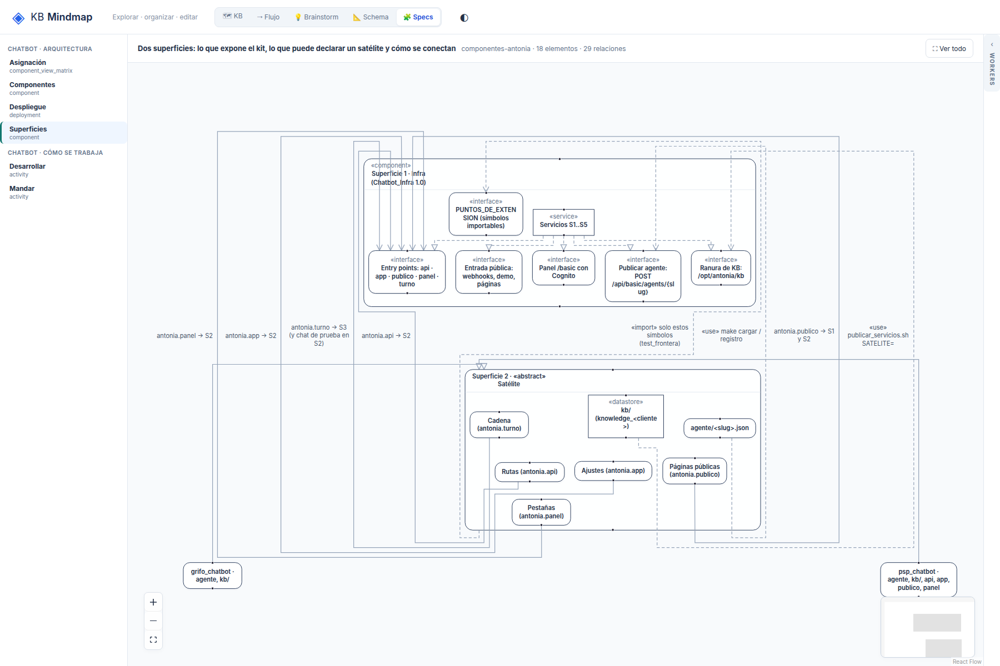

# R5: Las aristas cruzan el encabezado de los contenedores

## What
Las aristas que entran a un contenedor pasan por encima de su encabezado (título del contenedor).

## Expected
Ninguna arista cruza el encabezado de un contenedor.

## Where
frontends/mindmap/views/specs/notation (notation-layout.mjs, notation-view.js).

## Evidence
Ronda 2 del reporte de legibilidad (2026-10-19), sobre el store de prueba de solo lectura, después de b701555.
- 
- 

## Acceptance
Aserción: ningún tramo de arista intersecta la caja del encabezado de un contenedor.
Criterio (ronda 2): en /specs/notation, 1800x1200, «Ver todo»: texto ≥ 10 px, sin títulos tapados ni rótulos encimados, y además sin puntas de flecha sueltas, cada rótulo de arista a ≤ 20 px de su arista y el nodo inicial arriba. Cada issue tiene su aserción en tests/e2e_notation_legibility.py.

## Resolution

Closed: 2026-10-19
Reason: En vertical el título es un nodo en su propia fila (ELK rutea alrededor); en horizontal va en el padding y las aristas entran por los costados; candidatos con cruces se descartan; e2e: ninguna arista cruza un título.
Refs: 3bfb7f5
