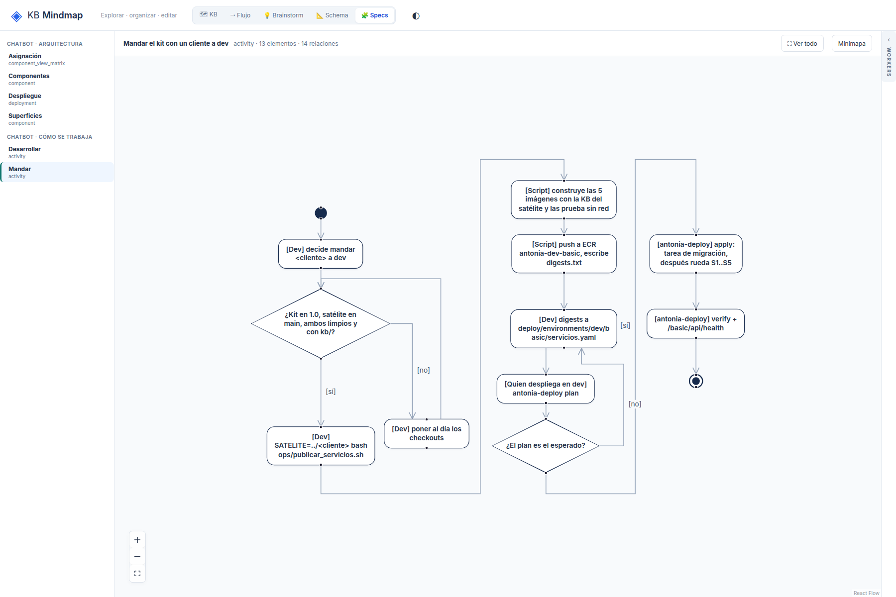

# R6: Las guardas de una decisión se leen invertidas entre ramas paralelas

## What
En una decisión con dos ramas que corren en paralelo (activity mandar-un-cliente, «¿El plan es el
esperado?»), el rótulo [no] queda más cerca de la línea de la rama [sí] y el [sí] encima de la línea del
[no]: cada uno está a 4 px de algún tramo propio, pero visualmente se leen cruzados.

## Expected
La guarda va en el primer tramo de su arista, pegada al vértice del rombo por donde sale, y está más cerca
de su propia arista que de cualquier otra, con un margen de al menos 8 px a las aristas ajenas.

## Evidence
Ronda 3 del reporte de legibilidad (2026-10-19), después de 3bfb7f5.
- 

## Acceptance
e2e: el rótulo de cada guarda está más cerca de su propia arista que de cualquier otra, con margen ≥ 8 px.
Obligatorio.
