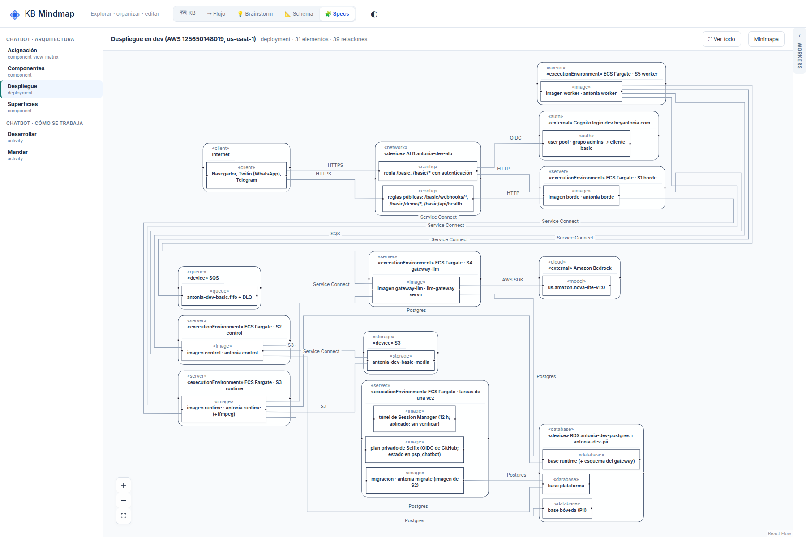
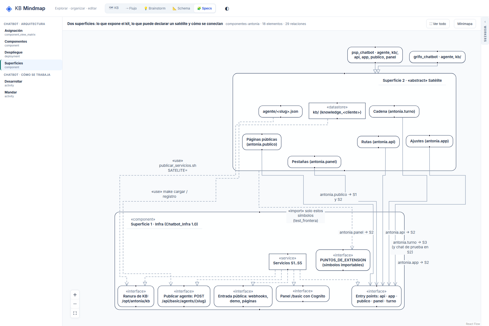

# R7: Haces de aristas paralelas que no se pueden seguir

## What
Varias aristas con el mismo rótulo corren juntas (deployment: 5-6 líneas «Service Connect»; superficies: 4
líneas antonia.* entrando a «Entry points»): se leen, pero no se puede seguir cuál va a dónde.

## Expected
Separación mínima entre paralelas y/o resaltar la arista al pasar el mouse sobre su rótulo o extremo, sin
romper los criterios ya cumplidos. Si no sale limpio, se cierra explicando por qué.

## Evidence
- 
- 

## Acceptance
Deseable.

## Resolution

Closed: 2026-10-19
Reason: Resaltado al pasar el mouse por la arista o su rótulo (la arista en acento y gruesa, las demás atenuadas). Separar más las paralelas (16 px) se probó y se descartó: el despliegue bajaba a 10.0 px y el fixture denso quedaba bajo 10 px, rompiendo la legibilidad ya cumplida.
Refs: 3eefb12
